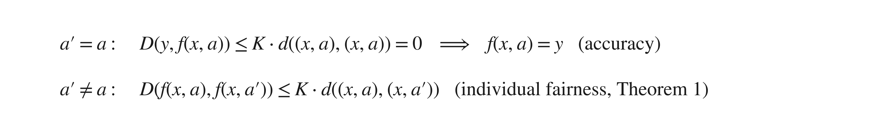
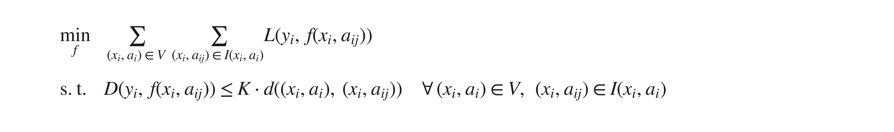
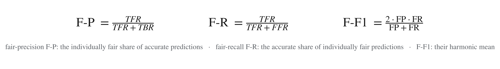

# Accurate Fairness Criterion

Code for *Accurate Fairness: Improving Individual Fairness without Trading Accuracy* (AAAI-23)

**Xuran Li, Peng Wu\*, Jing Su** · State Key Laboratory of Computer Science, Institute of Software, Chinese Academy of Sciences · University of Chinese Academy of Sciences

📄 **AAAI-23** · [arXiv:2205.08704](https://arxiv.org/abs/2205.08704) · *\*Corresponding author: Peng Wu*

> **TL;DR** — Accuracy and individual fairness are both crucial for trustworthy machine learning, but the two are often incompatible: enhancing one may sacrifice the other, with the side effects of *true bias* or *false fairness*. We propose a new fairness criterion, **accurate fairness**, to align individual fairness with accuracy. Informally, it requires the treatment of an individual and of the individual's similar counterparts to conform to a uniform target — the ground truth of the individual. We optimise it with a **Siamese fairness** in-processing approach and measure it with a **fairness confusion matrix**.

---

## Table of contents

1. [Motivation](#1-motivation)
2. [Accurate Fairness Criterion](#2-accurate-fairness-criterion)
3. [Siamese Fairness In-processing](#3-siamese-fairness-in-processing)
4. [Experimental Results](#4-experimental-results)
5. [Code](#5-code)
6. [Citation and Acknowledgments](#6-citation-and-acknowledgments)

---

## 1. Motivation

Accuracy and individual fairness are usually evaluated separately, and neither can tell on its own whether a prediction is *both* accurate and fair. For example, take one loan application and two similar applicants — same income, credit history and job, differing only in gender — whose application *should* be approved:

<p align="center"></p>

Only the top-left case, **Accurate Fair**, is what we want. The other three are the ways a model can *look* good on one metric while failing the other:

- **Accurate Bias** — the individual is predicted correctly, but the counterpart who differs only in the sensitive attribute gets a different answer. An accuracy-only evaluation never notices.
- **Inaccurate Fair** — the similar individuals get the same result, so individual-fairness metrics are satisfied, but that result is wrong. A fairness-only evaluation never notices.
- **Inaccurate Bias** — both wrong *and* biased.

Existing methods improve fairness or accuracy *separately*, so one is traded for the other and the model drifts into Accurate Bias or Inaccurate Fair. Accurate fairness is designed to rule out both.

## 2. Accurate Fairness Criterion

For an input `(x, a)` with non-sensitive attributes `x`, sensitive attributes `a` and ground truth `y`, its **similar sub-population** `I(x, a)` is the set of its similar counterparts — every version of the same person with a different sensitive value:

<p align="center"></p>

**Definition (Accurate Fairness).** A classifier `f` is *accurately fair* to `(x, a)` if, for every similar counterpart `(x, a') ∈ I(x, a)`,

<p align="center"></p>

One inequality captures both requirements. Taking `a' = a`, the right-hand side vanishes and the prediction must equal the ground truth — **accuracy**. Taking `a' ≠ a`, the predictions for similar individuals must stay within `K·d` of the ground truth, and therefore of each other — **individual fairness** (the Lipschitz condition of Dwork et al.):

<p align="center"></p>

<p align="center"></p>

Two consequences proved in the paper:

- **Theorem 1.** Accurate fairness implies the usual individual-fairness Lipschitz condition over the similar sub-population — it is a refinement of individual fairness built on top of accuracy.
- **Theorems 2–3.** Accurate fairness implies **statistical parity** and **confusion-matrix-based group fairness** over the union of similar sub-populations. Improving individual fairness this way improves group fairness as well.

## 3. Siamese Fairness In-processing

To improve the accurate fairness of a model, we train it under the accurate-fairness constraints:

<p align="center"></p>

By the Karush–Kuhn–Tucker conditions this is equivalent to a max–min problem with one Lagrange multiplier `λᵢⱼ ≥ 0` per similar individual:

<p align="center"></p>

A **Siamese network** is the natural way to optimise it: it feeds every member of a similar sub-population through `m` copies of the model with **shared parameters θ**, so the whole sub-population is treated uniformly in every back-propagation step.

<p align="center"></p>

1. **Fair augmentation** — for each training input `vᵢ = (xᵢ, aᵢ)`, generate its similar counterparts `(xᵢ, aᵢ₁), …, (xᵢ, aᵢₘ)`.
2. **Parallel forward pass** — each counterpart goes through its own copy of the model, all sharing `θ`.
3. **Accurate-fairness loss** — the task loss `L` plus the Lagrangian penalty for the constraint, summed over the sub-population.
4. **Update** — gradient ascent on `λ`, gradient descent on `θ`, until convergence (Algorithm 1 in the paper).

To the best of our knowledge this is the first time a Siamese approach has been adapted for bias mitigation. It works with any differentiable classifier; the repo includes fully-connected networks (FCNN), logistic regression (LR) and SVM.

## 4. Experimental Results

### Fairness confusion matrix

Because accurate fairness has two axes — *is the prediction correct?* and *is it consistent across the sub-population?* — every prediction falls into one of the four cells seen in the motivation figure. The paper names them True Fair / True Biased / False Fair / False Biased:

<p align="center"></p>

| Figure name | Paper name | Rate | Meaning |
|---|---|---|---|
| Accurate Fair | True Fair | TFR | Correct, and all similar counterparts get the same answer. |
| Accurate Bias | True Biased | TBR | Correct for the individual, but some counterpart gets a different answer. |
| Inaccurate Fair | False Fair | FFR | Wrong, but all similar counterparts get the same answer. |
| Inaccurate Bias | False Biased | FBR | Wrong *and* biased. |

From these rates we define three metrics that summarise the accuracy–fairness trade-off in one number each:

<p align="center"></p>

### Datasets

| Dataset | Size | Models | Sensitive attributes |
|---|---|---|---|
| Adult (Census Income) | 45,222 | FCNN, LR, SVM | gender, age, race |
| German Credit | 1,000 | FCNN, LR, SVM | gender, age |
| ProPublica Recidivism (COMPAS) | 6,172 | FCNN, LR, SVM | gender, age, race |
| Ctrip | 68,191 | FCNN (3 and 5 layers) | 6 customer consumption habits |

### Benchmark results

<p align="center"></p>

Share of each prediction type for a fully-connected classifier, averaged over the three benchmark datasets and ten runs (Table 3 of the paper). **iFair**, **LFR**, **SenSeI** and **SenSR** are state-of-the-art individual bias mitigation methods; **SF** / **SF_3** are our Siamese fairness models (SF_3 augments with only the min/max sensitive values to save computation). Ours have the largest true-fair share and almost no biased predictions of either kind.

Compared with the state-of-the-art individual bias mitigation techniques, Siamese fairness achieves on average:

| Metric | Improvement |
|---|---|
| Individual fairness (fairness through awareness) | **+1.02 % – 8.78 %** |
| Accuracy | **+8.38 % – 13.69 %** |
| True fair rate | **+10.09 % – 20.57 %** |
| Fair-F1 score | **+5.43 % – 10.01 %** |

The Fairea benchmark places only the SF and SF_3 models in the *win-win* region; every other method improves fairness at the cost of accuracy.

### Real-world case: service discrimination on Ctrip

Should customers who pay the same price for the same room receive the same room service, regardless of their consumption habits? Treating six consumption-habit attributes as sensitive, the baseline FCNNs do discriminate: only **34.68 %** of customers are served both accurately and fairly (TFR). With Siamese fairness the true fair rate rises to **62.85 %** — close to its ceiling, the models' accuracy of 65.77 % — and **93.00 %** of customers are served fairly irrespective of their habits.

| Metric | BL (3-layer) | SF_3 (3-layer) | BL (5-layer) | SF_3 (5-layer) |
|---|---|---|---|---|
| Accuracy | 0.664 | 0.660 | 0.666 | 0.655 |
| Fairness through awareness | 0.524 | **0.902** | 0.352 | **0.958** |
| True fair rate | 0.412 | **0.620** | 0.281 | **0.637** |
| True biased rate | 0.251 | **0.040** | 0.385 | **0.018** |
| Fair-F1 | 0.689 | **0.794** | 0.516 | **0.790** |

## 5. Code

### Repository layout

```
AccurateFairness/
├── prepare_<dataset>_data.py          # clean + fair-augment a dataset  (adult | credit | compas | ctrip)
├── train_<dataset>_siamese_fair*.py   # Siamese fairness in-processing
├── get_<dataset>_result.py            # evaluate baseline vs. SF models, print tables, draw charts
├── <dataset>_data/                    # train / test splits
├── <dataset>_model/                   # pre-trained baseline (BL_*) and Siamese fairness (FS_*) models
├── utils/
│   ├── utils_data_augmentation.py     # builds similar sub-populations I(x, a)
│   ├── utils_siamese_fair.py          # Siamese architecture + accurate-fairness loss
│   └── util_result.py                 # metrics: ACC, SPD/EOD/AVOD, CON, FTA, fairness confusion matrix
└── pic/                               # charts written by get_<dataset>_result.py
```

Pre-trained models are included, so the evaluation can be reproduced without training.

### Requirements

- Python 3.8
- `tensorflow==2.4.1`
- `keras==2.4.3`

### Reproduce the evaluation (no training needed)

```bash
cd AccurateFairness
python prepare_ctrip_data.py      # builds the test set and its similar counterparts
python get_ctrip_result.py        # evaluates the pre-trained BL and SF models
```

This prints accuracy, individual fairness, group fairness and accurate fairness for every model, and writes to `pic/`:

- a statistics table in the format of **Table 3** of the paper,
- `<dataset>_<method>.pdf` — fairness-confusion-matrix pie charts (**Figure 2**), where `method` is `bl` (baseline) or `sf` (Siamese fairness),
- `<dataset>_Fairea.pdf` — the Fairea trade-off evaluation (**Figure 3**).

Swap `ctrip` for `adult`, `credit` or `compas` to run the other datasets.

### Train a Siamese fairness model

```bash
cd AccurateFairness
python prepare_ctrip_data.py             # fair-augments the training set
python train_ctrip_siamese_fair.py       # Siamese fairness in-processing
```

The other datasets use `train_adult_siamese_fairness.py`, `train_credit_siamese_fairness.py` and `train_compas_siamese_fairness.py`.

## 6. Citation and Acknowledgments

```bibtex
@inproceedings{li2023accurate,
  title     = {Accurate Fairness: Improving Individual Fairness without Trading Accuracy},
  author    = {Li, Xuran and Wu, Peng and Su, Jing},
  booktitle = {Proceedings of the AAAI Conference on Artificial Intelligence},
  year      = {2023}
}
```

This work is partially supported by the National Key R&D Program of China (Grants 2022YFA1005100, 2022YFA1005101, 2022YFA1005104), the CAS-INRIA Joint Research Program (Grant GJHZ1844), the CAS Project for Young Scientists in Basic Research (Grant YSBR-040), the Beijing Academy of Artificial Intelligence (BAAI), and the Joint Laboratory on Cyberspace Security, China Southern Power Grid.

Questions or issues: open a GitHub issue or contact `lixuran93@gmail.com`.
